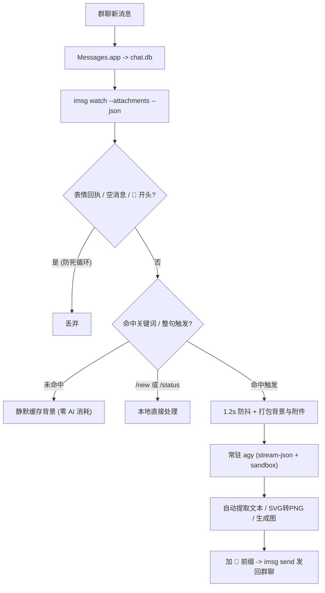

# iMessage × Antigravity 单群常驻机器人

基于 macOS 原生 `Messages.app` + [`steipete/imsg`](https://github.com/steipete/imsg) + Google Antigravity CLI（`agy --input-format stream-json`）的轻量单群 iMessage 聊天机器人。

**无需 OpenClaw、无需 BlueBubbles、无需额外 API Key，零第三方 Python 依赖**，直接复用本机 Antigravity 登录配额，且将 AI 文件与命令权限严格隔离在当前项目目录内。

---

## 核心特性

- **零冷启动常驻**：后台常驻单个 `agy` `stream-json` 进程，持续命中 Prompt Cache，响应更快、更省额度。
- **关键词触发 + 完整静默缓存**：未命中关键词的群消息零 AI 消耗，自动静默缓存（默认不限条数），下次触发时把上次触发后的全部群聊背景打包送入。
- **收图 / 发图 / SVG 画图**：
  - **收图**：自动将群里发送的图片复制进 `_inbox/`（HEIC 自动通过 macOS `sips` 转 JPG），不暴露 `~/Library/Messages/` 权限；支持图文同发与“先发图再提问”。
  - **SVG 矢量画图**：内置 `svg2png.py`（macOS `qlmanage` WebKit 渲染 + Pillow 自动按比例去白边），画卡片、图表、流程图零生图额度消耗。
  - **AI 生图自动发群**：自动捕获当前会话新生成的图片并归档进 `_outbox/` 发回群聊。
- **网页链接直抓**：内置 `fetch_url.py`，自动提取网页正文，内建防内网 SSRF 拦截（兼容 Clash/Surge 等 `198.18.0.0/15` Fake-IP 代理）。
- **持久化统计**：`/status` 查看当前会话/累计轮数、最近一轮与累计 Prompt 缓存命中率、累计消耗 Token 与运行时长，写入 `state.json`，退出重启或 `/new` 不清零。
- **严格目录沙箱**：首次运行自动根据当前路径生成 `agy_settings.json`，开启 `allowNonWorkspaceAccess: false` + `--sandbox`，仅白名单放行 `./svg2png.py` 与 `./fetch_url.py`，严禁越权读写或篡改机器人自身脚本。

---

## 工作流程



---

## 前置依赖（macOS）

1. **Python 3.9+**（macOS 自带；如需 SVG 自动去白边裁剪建议安装 `Pillow`：`pip3 install Pillow`）
2. **Google Antigravity CLI（`agy`）**：已在终端登录过一次（运行 `agy` 完成认证）
3. **[`steipete/imsg`](https://github.com/steipete/imsg)**：
   ```bash
   brew install steipete/tap/imsg
   ```
4. **macOS 系统授权**（系统设置 → 隐私与安全性）：
   - **完全磁盘访问权限**：勾选你运行机器人的终端应用（读取 `chat.db`）
   - **自动化**：允许终端控制 **信息（Messages.app）**（用于发消息）

---

## 快速上手（3 步）

### 1. 克隆并查看目标群 `chat_id`
```bash
git clone https://github.com/SgAlice/imessage-antigravity-bot.git
cd imessage-antigravity-bot
./start.sh --list-chats
```

### 2. 配置 `config.json` 与人设
首次运行会自动由 `config.example.json` 生成 `config.json`（也可手动 `cp config.example.json config.json`）。编辑 `config.json`，填入目标群的 `chat_id` 与触发词：
```json
{
  "chat_id": 1234,
  "keywords": ["@助手", "小助"],
  "exact_keywords": ["细说"],
  "allow_self_trigger": true,
  "model": "gemini-4-neon-low",
  "context_buffer_size": 0
}
```
- 如需自定义机器人性格、语气和规则，直接编辑 `GEMINI.md` 即可。
- 如用**独立副 Apple ID** 挂机，建议将 `allow_self_trigger` 设为 `false`；如用**主 Apple ID** 挂机，保持 `true` 即可通过 `🤖 ` 回复前缀防止死循环。

### 3. 启动常驻服务
```bash
./start.sh
```
- 不连 iMessage 单独测试沙箱对话：`./start.sh --test "你好，介绍一下你能做什么"`
- 群内内置命令：`@助手 /new`（重置上下文）、`@助手 /status`（查看轮数、Token 与缓存命中率）。

---

## 目录说明

| 文件 | 说明 |
| :--- | :--- |
| `bridge.py` | 核心常驻桥接服务（零第三方依赖） |
| `start.sh` | 一键启动脚本（内置 `caffeinate -i` 防息屏休眠） |
| `svg2png.py` | 目录隔离的 SVG → 高清 PNG 渲染脚本 |
| `fetch_url.py` | 防内网 SSRF 的只读网页正文抓取脚本 |
| `config.example.json` | 配置文件模板（本地运行使用被忽略的 `config.json`） |
| `agy_settings.template.json` | 权限沙箱模板（首次启动自动生成绑定当前目录的 `agy_settings.json`） |
| `GEMINI.md` | 机器人人设与行为规则模板 |

## License

MIT
